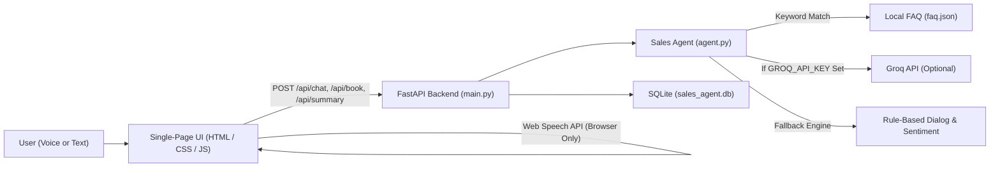

# FortiVex — Autonomous AI Sales Voice Agent (MVP Report)

## 1. Business Problem
Inbound sales teams lose qualified leads when prospects wait hours or days for a first response, especially outside business hours. Answering repetitive product questions, collecting basic qualification details, and scheduling initial discovery calls manually is slow and expensive. **FortiVex** demonstrates how an automated voice-and-text sales agent can handle first-touch qualification, answer grounded FAQ questions, and book demo slots immediately.

---

## 2. MVP Workflow
1. **Speak or Type**: The user interacts in English (`en-US`) or Hindi (`hi-IN`) using the browser microphone (Web Speech API) or the text input fallback.
2. **FAQ Grounding**: Incoming questions are matched against a local `faq.json` file using keyword scoring. Only retrieved FAQ context is used to answer product questions.
3. **One-at-a-Time Lead Qualification**: The agent tracks 7 lead fields (`name`, `company`, `role`, `need`, `budget`, `timeline`, `email`) and asks for missing fields one at a time.
4. **Basic Sentiment Estimate**: Each user message is tagged `positive`, `neutral`, or `negative` using simple keyword rules (clearly labeled as a basic estimate).
5. **Mock Appointment Booking & CRM**: Users can book a mock appointment (saving `lead_name`, `lead_email`, and date/time to SQLite). Lead details, transcript, sentiment, and a short call summary are stored as a mock CRM record and displayed live on the dashboard.

---

## 3. Architecture Diagram

---

## 4. Implemented vs. Simulated

| Component | Status in MVP | Notes |
|---|---|---|
| Voice Input & Spoken Replies | **Implemented (Browser)** | Uses Web Speech API (`SpeechRecognition` & `speechSynthesis`) in English/Hindi with text fallback. |
| Lead Qualification & FAQ Retrieval | **Implemented (Local)** | Tracks 7 fields one-by-one; matches `faq.json` via keyword scoring; optional Groq phrasing. |
| Sentiment Label & Call Summary | **Implemented (Basic)** | Keyword-rule sentiment estimate and concise summary generation. |
| CRM Record & Transcript Storage | **Simulated (Local SQLite)** | Stored in local `sales_agent.db` (`leads`, `messages`, `appointments` tables). |
| Calendar / Appointment Booking | **Simulated (Local SQLite)** | Saves name, email, and chosen date/time locally without Google/Outlook Calendar APIs. |
| Phone Calls / Telephony | **Simulated** | No PSTN, SIP, or Twilio integration; voice runs strictly in the browser. |

---

## 5. Security & Privacy Choices
- **No Hardcoded Secrets**: `GROQ_API_KEY` is read from environment variables / `.env` (with `.env.example` left blank).
- **No Audio Upload or Storage**: Speech recognition runs locally in the user's browser; only transcribed text is sent to the FastAPI backend.
- **Grounded Responses**: Product answers are constrained to `faq.json` so the agent does not invent product claims.
- **HTML Escaping**: User and agent messages are escaped in the frontend before rendering to prevent XSS.
- **Local-Only Scope**: No external CRM, calendar, or authentication exposure in this MVP.

---

## 6. Realistic Path to 100,000 Users
1. **Stage 1 — Hosted Multi-Tenant Backend (1k–10k users)**: Replace SQLite with managed PostgreSQL (with connection pooling) and move session state to Redis for horizontal scaling behind a load balancer.
2. **Stage 2 — Telephony & Real-Time Audio (10k–50k users)**: Add WebRTC / SIP media gateways (e.g., Twilio or LiveKit) with streaming STT/TTS and async task queues (Celery/RQ) for post-call CRM sync and summaries.
3. **Stage 3 — Production Scale (50k–100k+ users)**: Deploy containerized stateless API workers with autoscaling, vector search (e.g., pgvector) for large company knowledge bases, OAuth2/RBAC per tenant, and rate limiting/circuit breakers for LLM calls.

---

## 7. Operational Cost Factors
Moving from this local MVP to production introduces variable and fixed cost drivers (exact rates depend on provider tiers and usage volume):
- **LLM API Usage**: Token volume for conversation turns, FAQ grounding, and call summarization.
- **Speech-to-Text & Text-to-Speech**: Per-minute or per-character billing if replacing browser Web Speech API with cloud STT/TTS for phone calls.
- **Telephony**: Per-minute inbound/outbound voice charges and phone number rental.
- **Infrastructure**: Managed database (PostgreSQL), cache (Redis), compute instances, and monitoring/logging storage.
